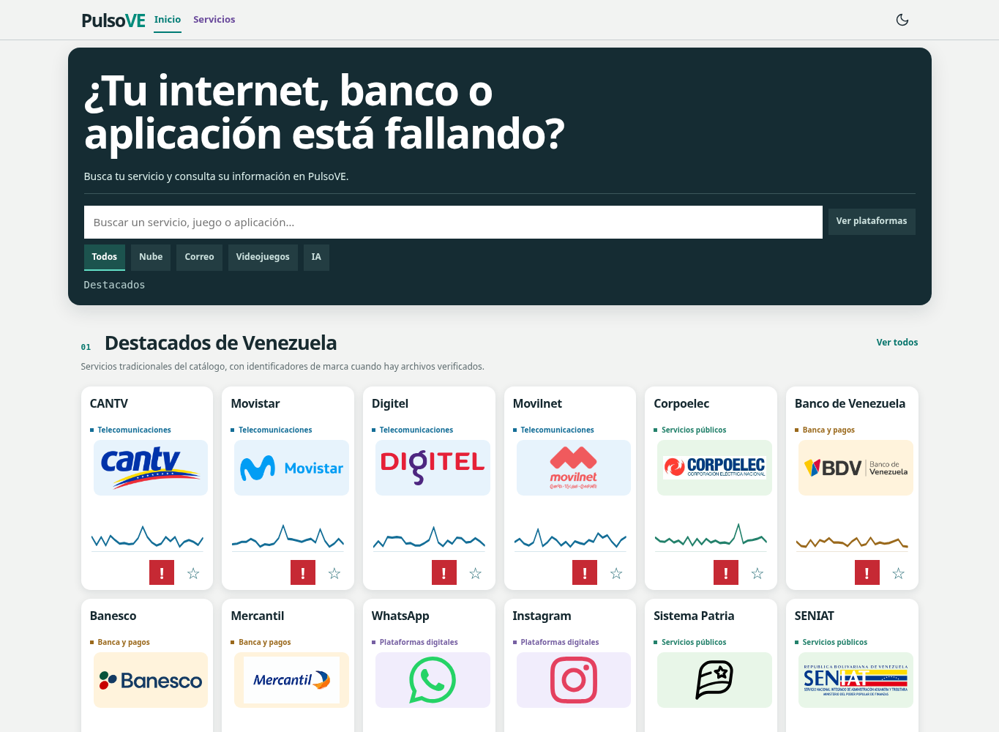
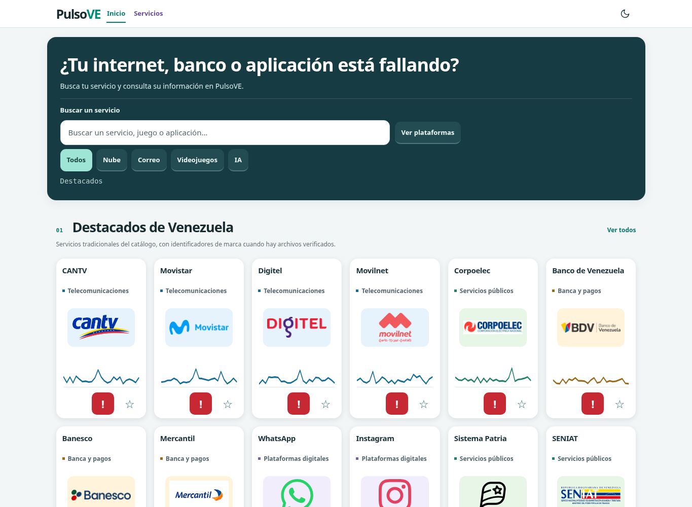
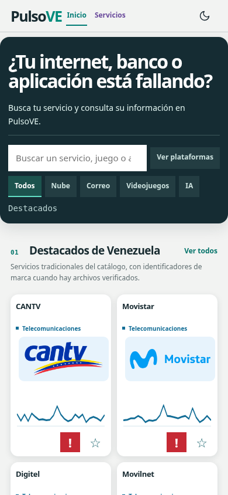
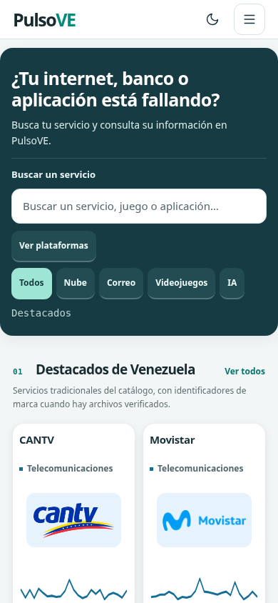

# Revisión y mejoras visuales de PulsoVE

Se aplicó la revisión sobre `main` en `4f09649`: se conservan las **579 fichas, 18 categorías y 179 logotipos locales**, los créditos, favoritos, comentarios, gráficas y fuentes existentes. La vista pública usa la ruta actual `/web-pulso-ve/`. Los cambios de Next.js se dejan en una rama para revisión; la vista estática se publica en `gh-pages` sin fusionar `main`.

## Cambios y motivos

- **Portada:** título con tamaño contenido, etiqueta visible y campo de búsqueda destacado. Los filtros tienen una selección visible y controles amplios. Se mantiene la guía de uso en el pie de página.
- **Tarjetas:** tipografía más legible, cabeceras alineadas, superficies y esquinas consistentes; se mantienen los logotipos y colores de categoría, sin convertirlos en señales de disponibilidad. Los controles de reporte/favoritos tienen un objetivo de 44 px.
- **Estados:** la ficha estática presenta «Estado actual no consultado» en un indicador neutral. El resumen de Next.js conserva «Sin datos suficientes» cuando faltan pruebas; cero incidentes no produce un falso estado normal. Colores de estado con tokens separados para claro y oscuro.
- **Móvil:** menú desplegable nativo en Pages, utilizable también sin JavaScript. Se cierra al navegar, salir con Tab o pulsar Escape. A 320 px se usa una tarjeta por fila; se conserva la densidad del catálogo en pantallas mayores. La cabecera mantiene una sola fila de 54 px.
- **Consistencia:** controles, fichas y textos usan superficies, espaciados y colores coherentes en ambos temas. Se respeta movimiento reducido. Se evita la transición de fondo que dejaba texto claro sobre la superficie clara unos instantes al cambiar de tema.
- **Interacción:** se corrigió el clic de favoritos después de escribir una búsqueda: el filtrado reinsertaba las mismas tarjetas al perder foco y podía cancelar el clic. Ahora solo reordena nodos cuando cambia su orden.

## Comparación con los mismos datos

Capturas reales de Chromium, con igual catálogo, tamaño y estado inicial; no son maquetas generadas.

| Antes — escritorio claro | Después — escritorio claro |
| --- | --- |
|  |  |

| Antes — móvil | Después — móvil |
| --- | --- |
|  |  |

También se guardaron capturas de [portada oscura antes](evidencias/visual-2026-11-14/antes-inicio-oscuro.png), [después](evidencias/visual-2026-11-14/despues-inicio-oscuro.png), [directorio antes](evidencias/visual-2026-11-14/antes-directorio-oscuro.png) y [después](evidencias/visual-2026-11-14/despues-directorio-oscuro.png).

## Verificación

- `npm run test:unit`: **165 pruebas aprobadas**. Se añadieron casos de estado neutral y priorización de señales.
- `npm run typecheck`: aprobado.
- `npx tsx scripts/build-pages-global-demo.mjs` y `node scripts/check-pages-global-demo.mjs`: construcción y comprobación de las 579 fichas, marcas y privacidad aprobadas.
- `NODE_PATH=/ruta/a/playwright-core/node_modules node scripts/smoke-visual-current.cjs`: menú, Tab/Escape, búsqueda, favoritos tras buscar, recarga de ficha, gráficas, formulario sin transmisión, estados vacíos y anchos 320/390/768/1365 px aprobados. Sin solicitudes externas, escrituras, recursos ausentes ni errores de navegador en el recorrido.
- `python tests/global-pages-browser.py`: suite existente aprobada; conserva comprobaciones de geometría, fallback de marcas, historial y formulario. Solo se adaptaron expectativas de tamaños/menú acordes al diseño y la espera de carga al regresar al directorio.
- CSS de producción compilado con Tailwind y `scripts/check-next-visual.cjs`: buscador/botón en la misma fila móvil, etiqueta encima y resumen claro sobre superficie clara aprobados. Comprobación focalizada, no un despliegue completo de Next/PostgreSQL.
- Textos principales medidos en la demo: contraste mínimo **4,95:1** en claro y superior en oscuro. No acredita una evaluación WCAG completa.

La revisión independiente detectó dos fallos de la primera adaptación Next: especificidad del fondo del resumen y etiqueta de búsqueda móvil. Ambos fueron corregidos y comprobados con CSS real en Chromium. El clic de favoritos y el contraste durante el cambio de tema fallaron en pruebas antes de corregirse.

No se modificaron esquema, migraciones ni endpoints. No se repitió la integración DB. El repositorio actual aún declara `next lint`, sin configuración ESLint para Next 16; no se afirma que lint haya pasado ni se cambia ese asunto en esta entrega. Evidencia: [resultados JSON](evidencias/visual-2026-11-14/resultados.json).

Los datos de la demo continúan siendo ilustrativos. No se añaden fuentes de terceros ni se modifica la procedencia/licencia de las marcas existentes. GitHub sirve los archivos públicos; los reportes de demostración no se transmiten. La vista previa no acredita operación productiva, conformidad legal integral ni certificación ITIL/ISO. La publicación puede revertirse mediante un nuevo commit de reversión del cambio en `gh-pages`, sin tocar datos o reescribir historia.

## Entrega

Rama fuente `feat/visual-refresh-current`, implementación `89a9b41`; artefacto publicado en `gh-pages` (`6c20075`, avance normal desde `da8e7aa`). Se descargó el HTML de GitHub y coincidió byte a byte con el probado. El análisis Gitleaks no detectó secretos en el artefacto. `main` permanece en `4f09649`.

Dirección pública: https://medinacaj.github.io/web-pulso-ve/. El proxy del entorno rechazó la conexión a ese host con `CONNECT 403`; no se pudo confirmar la disponibilidad pública desde aquí. Esto no es una respuesta de la web publicada ni demuestra una caída.
