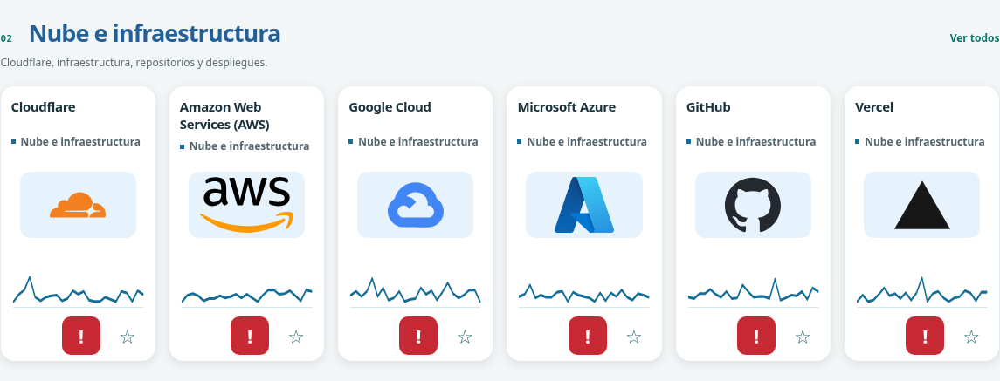
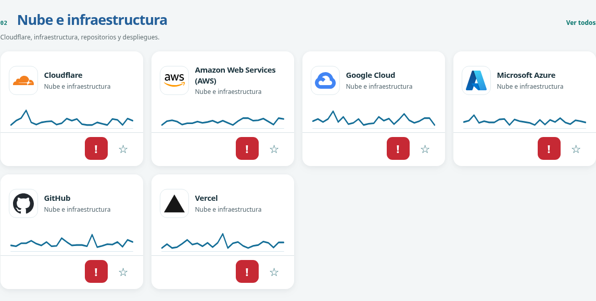

# Tarjetas modernizadas y corrección de la captura

La captura del usuario mostró el problema que persistía: el nombre reservaba espacio aun en una sola línea, la cabecera tenía un bloque de altura fija separado del logo y el gráfico quedaba lejos. Cambiar radio, color o sombra conservaba esa composición. Se sustituyó por una **fila de identidad con marca a la izquierda y nombre/categoría agrupados a la derecha**, seguida de una gráfica compacta y acciones en un pie independiente.

| Antes | Después |
| --- | --- |
|  |  |

- Altura medida: **315 → 221 px**, reducción del **29,8 % por tarjeta**.
- Nombre y categoría: **4 px de separación**; sin reserva artificial de 32/80 px entre textos.
- Logos: marco neutral común **56 × 56 px**, imagen contenida **40 × 40 px**, relación de aspecto original conservada. No se recortaron ni modificaron los archivos de marca.
- La gráfica queda próxima a la identidad; favoritos y reporte mantienen controles de 44 px, separados del enlace de la ficha.
- Cuadrícula de **4/3/2/1 columnas** según ancho, para dar espacio legible al nombre junto al logo. La reducción indicada es por tarjeta, no una afirmación sobre la altura total de cada sección.

[Versión móvil](evidencias/tarjetas-2026-11-14/despues-movil.png) · [Tema oscuro](evidencias/tarjetas-2026-11-14/despues-oscuro.png) · [Mediciones y pruebas](evidencias/tarjetas-2026-11-14/resultados.json).

Se conservan las 579 fichas, los 179 activos de marca, gráficos ilustrativos, favoritos, enlaces y formulario sin transmisión. La aplicación Next usa la misma composición en `ServicePulseCard`, manteniendo sus reportes, estados y lógica real. No cambian DB, API ni archivos de marca.

## Verificación

- `scripts/check-modern-cards.cjs`: la prueba falló antes por faltar la identidad horizontal; pasó después. Mide las seis tarjetas señaladas a **1365, 768, 390 y 320 px**: escala, ajuste `contain`, distancia entre textos, proximidad de gráfica y altura compacta.
- Suite Chromium existente del catálogo y recorrido general: aprobados; 579 fichas, favoritos, búsqueda, detalle/gráficas, teclado, responsive, sin transmisiones ni solicitudes externas. Las expectativas de geometría se actualizaron a la nueva composición, manteniendo las comprobaciones de colisiones y acciones independientes.
- **165 pruebas unitarias**, TypeScript y compilación de CSS de producción: aprobados. No se ejecutó la aplicación Next completa con PostgreSQL en esta tarea.
- Revisión independiente: 579 tarjetas a 320/560/840/1120 px, sin nuevos solapamientos ni desbordamiento demostrados. No equivale a una auditoría completa de accesibilidad.

Los cambios se publican en `gh-pages`, con avance normal de Git y sin fusionar `main`. La comparación se obtuvo de las mismas seis marcas y el mismo viewport; son capturas reales de Chromium.

Publicación: `gh-pages` en `86a6cc5`. Se descargó el HTML de GitHub y coincidió byte a byte con el artefacto probado. La disponibilidad de la URL pública no se comprobó desde el entorno, cuyo proxy bloquea el host de Pages.

## Pendiente para una próxima iteración

El usuario prefiere los logotipos de mayor tamaño de la versión anterior y solicitó guardar el cambio para retomarlo más adelante. Pendiente: aumentar de nuevo su presencia visual, revisando tamaño y composición de las tarjetas sin deformar las marcas ni recuperar los huecos excesivos señalados. El ajuste queda diferido; esta anotación no cambia la demo publicada.

El usuario añadió como pendiente reducir el tamaño visual y mejorar la integración de los iconos de exclamación (reportar) y estrella (favoritos). Aplicar una ampliación ligera al pasar el cursor, sin mover el contenido de la tarjeta; ofrecer respuesta equivalente al foco de teclado y respetar movimiento reducido. Mantener un área cómoda de interacción en pantallas táctiles aunque el icono visible sea más pequeño. Este ajuste también queda diferido.
